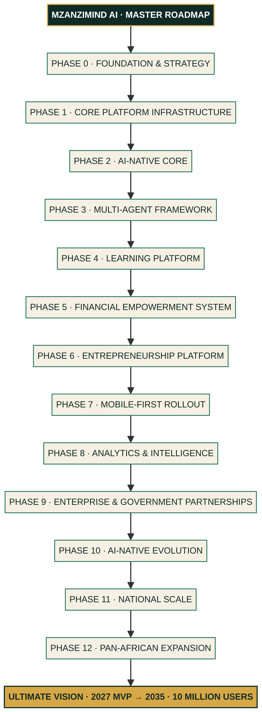

# Roadmap

## Phase 1 (Year 1)

MVP Development

AI Tutor
AI Budget Coach
Career Coach
Mobile App

## Phase 2 (Year 2)

Entrepreneurship Platform

Business Mentor
Funding Assistant
Marketplace

## Phase 3 (Year 3)

National Rollout

Schools
TVET Colleges
Universities
Municipalities

## Phase 4 (Year 5)

Pan-African Expansion

Kenya
Nigeria
Ghana
Botswana
Namibia
